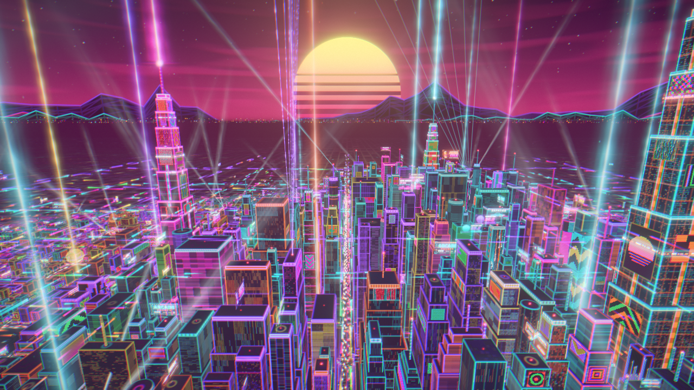
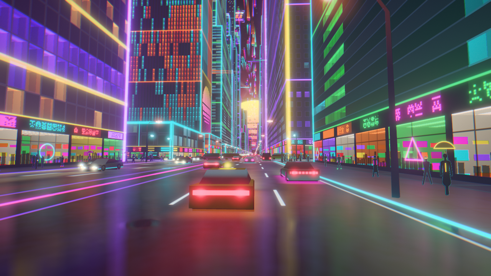
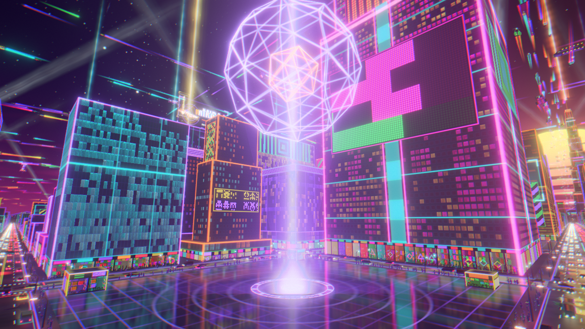
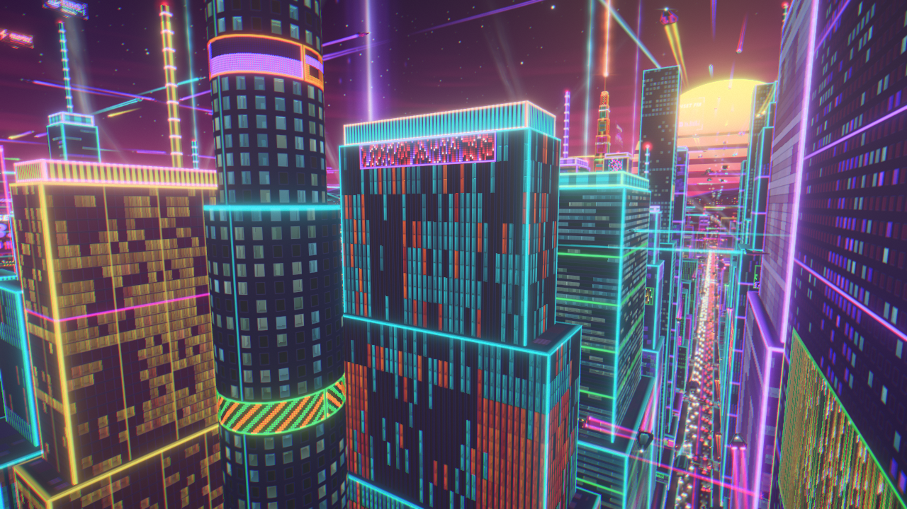

# Synthwave City

An endless 80s-synthwave megacity you fly through in the browser.

**Play it:** https://highsierralabs.github.io/Synthwave_City/

| | |
|---|---|
|  |  |
|  |  |

Neon towers with lit windows and glowing edges. Rivers of flying traffic stacked between them.
Searchlights, beacon pillars and laser fans shimmering in the haze. Holographic billboards hanging in
the air. Streets full of headlights and tail lights, mirrored in wet asphalt. A striped sun that never
sets, and a soundtrack that is synthesized while you listen.

Everything is generated by code when the page opens. There are no image, model, font or sound files.

## Run it

Needs [Node.js](https://nodejs.org) 24.

```
npm ci
npm run dev        # http://127.0.0.1:5180
```

Build the static site:

```
npm run build      # writes dist/
npm run preview    # serves dist/ on http://127.0.0.1:5181
```

`dist/` is plain HTML, CSS and JavaScript and runs from any folder on any static host. It needs a
browser with WebGL2.

## Controls

| | |
|---|---|
| Look | Move the mouse (click the city to capture the pointer) |
| Fly | `W` `A` `S` `D` |
| Down / up | `Q` / `E` |
| Boost | Hold `Shift` |
| Tour on / off | `Space` |
| Viewpoints | `1` to `6` |
| Next mood | `T` |
| Next radio station | `R` |
| Mute | `M` |
| Photo mode | `P` |
| Stats | `H` |
| Menu | `Esc` |

The city starts on an automatic tour. Move the mouse or press a movement key to take over; `Space`
hands control back. Buildings are solid: you slide along them. On a touchscreen, drag to look, hold
to fly, and add a second finger to boost.

The menu has three moods (Sunset, Midnight, Miami), three detail levels (changing it reloads the
page), sound on or off, and an optional CRT scanline look. Choices are remembered in this browser.

**Radio.** Five stations play in the city, each a different kind of synthwave, all of it
synthesized as it plays: Sunset FM 88.8 (outrun), Obsidian 93.3 (darksynth), Velvet 97.1
(chillwave), Starport 101.5 (spacesynth) and Plaza 104.3 (mallsoft). Pick one in the menu's Radio
row or press R to turn the dial. The stations keep broadcasting while you listen to another, so
tuning in lands somewhere in the middle of a song. Their billboards are on the towers.

**Other cities.** Every city grows from one number, its seed; the original is 1984. The menu's City row
shows the number of the city you are in. Type another (any whole number from 1 to 4294967295) and press
Go, or press New for a random one; the page reloads into that city. The number is also put in the
address, as `?seed=7` for example, so a city you like can be bookmarked or shared. The street grid,
the sun and the mountains are the same in every city; districts, towers, signs, traffic, the tour and
the music change.

**Full screen.** The menu has a Full screen switch, and on a phone or tablet a button beside the menu
button does the same while you fly. Safari on iPhone does not let a page go full screen; there, use
Share, Add to Home Screen, and open the city from its icon, which runs it without Safari's bars.

## How it works

- **One tile, wrapped.** The city is a single 6.4 km square that repeats. Nothing is streamed: every
  shader places its geometry relative to the camera, wrapped to the nearest copy, so you can fly
  forever in any direction and no number on the GPU ever grows large. Fog and a far fade hide the
  repeat.
- **A deterministic plan.** A seed becomes districts, about 17,000 building boxes, 520 traffic lanes
  on the ground and in the air, and about 2,000 sites for holograms, searchlights and beacons. The
  same seed gives the same city on every machine.
- **Layers.** Sky, ground, buildings, street life, air traffic, light shafts and holograms are
  separate modules that share only the plan and a set of uniforms. Each one is a few instanced draw
  calls with a custom GLSL shader.
- **Motion on the GPU.** Vehicles are placed along their lanes in the vertex shader from one clock
  value, so tens of thousands of them cost the CPU nothing per frame.
- **Light.** The frame is rendered in linear HDR, mirrored once for the wet streets, bloomed, and
  tone-mapped with a curve that keeps neon saturated.
- **Sound.** A small sequencer writes drums, bass, pads and a lead; Web Audio oscillators and noise
  play them. The neon pulses on the beat.

The design is in [architecture.md](architecture.md). How to work on the code is in
[Agents.md](Agents.md). The build was split into fourteen tasks, each with a plan in [plans/](plans).

## Tech

TypeScript 6, [three.js](https://threejs.org) 0.187 on WebGL2, custom GLSL,
[postprocessing](https://github.com/pmndrs/postprocessing) 6.39 for bloom, the Web Audio API,
Canvas 2D for billboard art, [Vite](https://vite.dev) 8 to build, [Vitest](https://vitest.dev) for
unit tests and [Playwright](https://playwright.dev) for screenshots and a smoke run.

```
npm run check      # typecheck, lint, unit tests
npm run smoke      # build, serve, boot in Chromium on the GPU, check errors and frame time
node scripts/shot.mjs --url "/dev/?layers=all&view=high&t=12" --out shots/high.png
```

`/dev/` is a harness that mounts any subset of layers at a fixed camera and time; see the comment at
the top of `dev/main.ts`.

## Where it came from

This is a different take on [Afterglow City](https://github.com/J-o-h-n-M/afterglow-city) by John
(MIT), a dusk city you fly through, drawn with raw WebGPU in a single HTML file, itself based on
[Abyssal Garden](https://github.com/Noniv/abyssal-garden) by Maksymilian Dendura. The idea of a
procedural city you fly through, with viewpoints on the number keys, detail levels and a synthesized
soundscape, comes from there. None of its code is used: Synthwave City is written from scratch on a
different stack, with a different world model and a different look. The request that started the
project is in [docs/user_prompt.md](docs/user_prompt.md).

## What has and has not been tested

It was built and measured on one machine: an RTX 4070 SUPER on Windows, in Chromium. There it holds
its frame budget at 2560x1440 with room to spare, and the automated checks (unit tests, a smoke run
of the built site, a scripted pass over every control) pass. The author has played it there. It has
not been tried on other GPUs, on phones, or in Firefox or Safari; the Low and Medium detail levels
exist for slower machines but have only been run on the fast one. The full record, including the
list of things only a person can judge, is the last section of
[plans/T13-art-pass.md](plans/T13-art-pass.md).

## Contributing

See [CONTRIBUTING.md](CONTRIBUTING.md). Please open an issue before writing code.

## License

[MIT](LICENSE). The built site contains three.js and postprocessing; their licences are in
[THIRD-PARTY-NOTICES.md](THIRD-PARTY-NOTICES.md).
